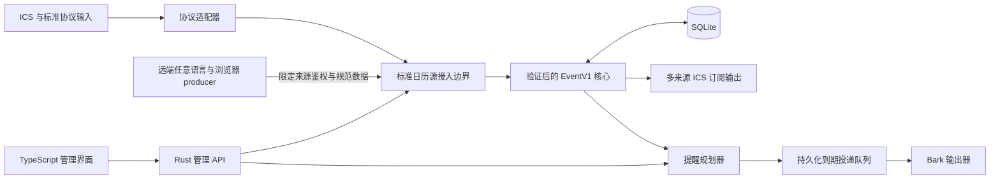

# CalRelay

统一接入日历与事件，可靠地生成日历订阅和定时提醒。

状态：已实现事件领域、持久化同步/规划/租约、协议适配、管理鉴权、汇总订阅与恢复；标准 binary 安全装配实际来源扫描、规划和投递三工作器。运行与预算见[生产运行时](docs/production-runtime.md)。来源管理旅程已接入；规则/输出/订阅前端及 Docker/静态网页交付仍待整体验收，不能据此认定整个产品完成。

CalRelay 的目标是 Docker 交付、高度可定制的提醒平台：在前端管理来源/接入器、周期、日历选择、规则、输出和订阅。核心是自定义标准日历源与 EventV1 数据契约，ICS 只是输入协议之一；支持配置的协议适配器及经鉴权的远端任意语言/浏览器扩展 producer。详见[产品 DFD/UML 与实现差距](docs/product-design.md)。

以下为目标概览；pull 周期只用于支持更新的源，static/manual/push-only 不虚构轮询。日历客户端通过 GET 读取汇总 ICS，Bark 由到期规则和持久队列驱动。

首版采用 Rust 模块化单体、TypeScript 管理界面、单实例 SQLite 和 Docker 部署。核心服务持续提供网页/API、协调来源刷新、规划与投递，并监督实际工作器；composition root 与 runtime supervisor 分工，业务模块通过明确接口协作，核心不依赖具体接入器或输出器。核心暴露真实健康状态，恢复和 Docker 重启由外部部署机制负责，不承诺永不掉线。

| 文档 | 内容 |
| --- | --- |
| [产品 DFD/UML](docs/product-design.md) | 目标数据流、组件、时序、标准源契约与现状差距 |
| [架构设计](docs/architecture.md) | 模块、依赖、同步与投递事务、API 边界 |
| [事件与存储模型](docs/event-model.md) | 时间、重复事件、修订、关系表、结构契约 |
| [运行与安全](docs/operations.md) | Cloudflare、Docker、健康检查、备份与恢复 |
| [实施路线](docs/roadmap.md) | 分阶段范围与验收条件 |
| [验证工具](docs/verification-toolkit.md) | 按 Issue 风险与 TDD 需要选用的测试、证明及质量能力 |
| [项目参考](docs/references.md) | 官方规范、文档、公共代码及采用理由 |
| [贡献指南](CONTRIBUTING.md) | Issue、分支、PR、CI、评审与合并约定 |
| [事件结构草案](schemas/event-v1.schema.json) | JSON Schema Draft 2020-12，已实现的领域边界与显式能力限制 |
| [事件示例](examples/event-v1.json) | 带时区的重复会议及单次改期 |

仓库：[freesialuo/CalRelay](https://github.com/freesialuo/CalRelay)。项目名意为日历与提醒的中继。

TypeScript 管理入口已有真实登录与来源 CRUD；规则/输出/订阅前端及生产静态资源仍待接通。开发与验证见[管理前端](docs/admin-web.md)。
