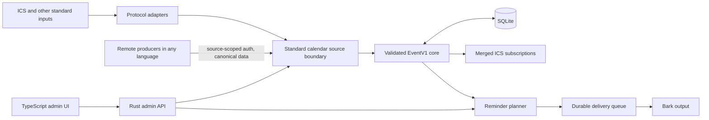

# CalRelay

**English** · [简体中文](README.zh-CN.md)

[](https://github.com/freesialuo/CalRelay/actions/workflows/ci.yml)
[](LICENSE)

A self-hosted calendar hub written in Rust. CalRelay takes in calendar events from ICS feeds and from producers that push over an authenticated API, serves merged ICS subscriptions to calendar clients, and sends timed reminders through [Bark](https://github.com/Finb/Bark).

The name means a relay for calendars and reminders.

> [!NOTE]
> **Status: first alpha, not a finished product.** The loop from source to reminder runs end to end in the standard binary, and the admin UI manages sources, rules, Bark outputs and merged subscriptions. More source adapters, a full audit export and parts of the system acceptance matrix are still open. The [roadmap](docs/roadmap.md) lists what has shipped and what remains.

## What it does

- **Many sources, one event model.** Pull remote ICS subscriptions on a schedule, upload an ICS snapshot by hand, or let a producer written in any language push event batches with a token scoped to one source. Every event is validated into the [EventV1 contract](schemas/event-v1.schema.json). ICS is one input protocol, not the core model.
- **Merged subscriptions out.** Calendar clients read one aggregated ICS feed with stable UIDs and support for conditional requests.
- **Reminders that survive failure.** Rules turn events into reminder jobs. A durable queue with leases delivers them to Bark, retries after an outage, and does not repeat a reminder that was already delivered when the server restarts.
- **Managed from the browser.** A TypeScript admin UI talks to a versioned Rust API to manage sources, rules, outputs, subscriptions and producer tokens, and to read diagnostics and the audit trail of management changes.
- **One container.** The Rust binary serves the compiled UI and keeps everything in a single SQLite database. The example Compose file runs it read-only with all capabilities dropped.

## How it works



CalRelay is a modular monolith. Five crates depend on each other in one direction, and the core does not know about any specific source adapter or output.

| Crate | Responsibility |
| --- | --- |
| `calendar-domain` | Event types, time semantics, recurrence rules and validation. No network or database dependency. |
| `calendar-application` | Ingestion coordination, sync commits, event queries, reminder planning and delivery use cases. |
| `calendar-adapters` | ICS, HTTP JSON, Bark, ICS rendering and authentication. |
| `calendar-storage` | SQLite repositories, transactions, migrations, leases and backup. |
| `calendar-server` | HTTP routes, worker startup, configuration, health checks and wiring. |

The server supervises three workers: source scanning, reminder planning and delivery. It reports real liveness and readiness. Restarting a failed process is left to the deployment, for example a Docker restart policy. CalRelay does not claim it never goes down.

## How it is verified

- **Rust tests.** More than 400 tests across the workspace, with `cargo fmt` and Clippy at `-D warnings`, all in the required `quality-gate` check.
- **Contracts.** The event JSON Schema, its examples and its rejection cases are checked in CI.
- **Browser tests.** The admin UI is tested with Playwright at smoke, component, integration and system level against a real local server.
- **Failure tests on the real server.** The system suite [kills and restarts the process](https://github.com/freesialuo/CalRelay/pull/203), returns 503 from a source and from Bark, [stalls an upstream](https://github.com/freesialuo/CalRelay/pull/207), panics a worker and [locks the database](https://github.com/freesialuo/CalRelay/pull/217). It checks that configuration survives, delivered reminders are not repeated, and [interrupted reminders are delivered after recovery](https://github.com/freesialuo/CalRelay/pull/211).
- **Bounded proofs.** [Kani](docs/formal-verification.md) proves the recurrence expansion budget and the time-window check within stated bounds. A separate step mutates the code to confirm each proof can fail.

The [verification toolkit](docs/verification-toolkit.md) explains how a change picks its level of testing.

## Run it

```sh
docker build --target runtime --tag calrelay:local .
cp examples/docker-deployment.json deployment.json
mkdir -p secrets
docker compose config --quiet
docker compose up -d
```

The example deployment file holds synthetic identities only. Before a real deployment, replace them and prepare the master key and secrets as described in [Docker foundation](docs/docker-foundation.md). The admin entry is `/admin/` and must sit behind Cloudflare Access or another trusted reverse proxy; see [operations and security](docs/operations.md).

A `v0.1.0-alpha.1` image for `linux/amd64` has been built and verified. Its registry is private for now, so build the image locally.

First-alpha limits: one instance with SQLite, one calendar per ICS document, and no write-back to remote calendars.

## Develop

```sh
cargo fmt --all --check
cargo clippy --workspace --all-targets --all-features --locked -- -D warnings
cargo test --workspace --all-features --locked
python3 -m unittest discover -s tests -v
python3 scripts/check_repository.py
```

Install `requirements/ci.txt` before the two Python commands. Frontend commands are in [admin web](docs/admin-web.md).

## Documentation

The documents below are written in Chinese.

| Document | Contents |
| --- | --- |
| [Product design](docs/product-design.md) | Target data flow, components, sequences, the standard source contract and gaps |
| [Architecture](docs/architecture.md) | Modules, dependencies, sync and delivery transactions, API boundaries |
| [Event and storage model](docs/event-model.md) | Time, recurring events, revisions, tables and the structural contract |
| [Operations and security](docs/operations.md) | Cloudflare, Docker, health checks, backup and recovery |
| [Production runtime](docs/production-runtime.md) | The three workers and their resource budgets |
| [Roadmap](docs/roadmap.md) | Scope by phase, acceptance criteria and what remains |
| [Verification toolkit](docs/verification-toolkit.md) | Tests, proofs and quality tools chosen by risk |
| [References](docs/references.md) | Specifications, documentation and public code that were used |
| [Event schema](schemas/event-v1.schema.json) | JSON Schema Draft 2020-12 for EventV1 |
| [Event example](examples/event-v1.json) | A recurring meeting with a time zone and one rescheduled instance |

## Contributing

Every change starts from an issue and reaches `main` through a branch, a pull request and CI. A pull request is merged only after the maintainer approves it explicitly. See [CONTRIBUTING.md](CONTRIBUTING.md) (Chinese) and [AGENTS.md](AGENTS.md).

## License

[AGPL-3.0-only](LICENSE). If you run a modified version as a network service, the license requires you to offer its source code to the users of that service.
