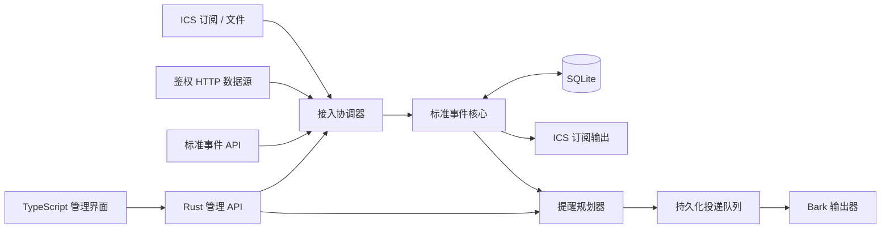

# CalRelay

统一接入日历与事件，可靠地生成日历订阅和定时提醒。

状态：架构设计阶段，尚无可运行服务。当前文件定义目标架构与实现约束，不表示相关功能已经实现。

首版采用 Rust 模块化单体、TypeScript 管理界面、单实例 SQLite 和 Docker 部署。模块通过明确接口协作，核心不依赖具体接入器或输出器。

| 文档 | 内容 |
| --- | --- |
| [架构设计](docs/architecture.md) | 模块、依赖、同步与投递事务、API 边界 |
| [事件与存储模型](docs/event-model.md) | 时间、重复事件、修订、关系表、结构契约 |
| [运行与安全](docs/operations.md) | Cloudflare、Docker、健康检查、备份与恢复 |
| [实施路线](docs/roadmap.md) | 分阶段范围与验收条件 |
| [项目参考](docs/references.md) | 官方规范、文档、公共代码及采用理由 |
| [贡献指南](CONTRIBUTING.md) | Issue、分支、签名、PR、CI、评审与合并约定 |
| [事件结构草案](schemas/event-v1.schema.json) | JSON Schema Draft 2020-12，待实现的 v1 契约 |
| [事件示例](examples/event-v1.json) | 带时区的重复会议及单次改期 |

仓库：[freesialuo/CalRelay](https://github.com/freesialuo/CalRelay)。项目名意为日历与提醒的中继。
