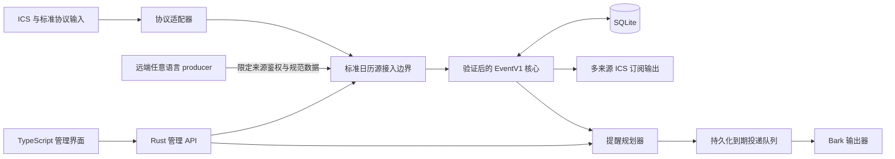

# CalRelay

[English](README.md) · **简体中文**

[](https://github.com/freesialuo/CalRelay/actions/workflows/ci.yml)
[](LICENSE)

用 Rust 编写的自托管日历中枢。CalRelay 统一接入 ICS 订阅和经鉴权接口推送的事件，向日历客户端提供合并后的 ICS 订阅，并通过 [Bark](https://github.com/Finb/Bark) 发送定时提醒。

项目名意为日历与提醒的中继。

> [!NOTE]
> **状态：首个 alpha，不是完成的产品。** 标准 binary 已能跑通从来源到提醒的完整链路，管理界面可以管理来源、规则、Bark 输出和汇总订阅。更多接入器、完整的审计导出和部分系统验收矩阵仍未完成。已交付与剩余范围见[实施路线](docs/roadmap.md#首个-alpha-对账2026-10-26)，不能据此认定整个产品完成。

## 功能

- **多种来源，一个事件模型。** 按周期拉取远程 ICS 订阅，手动上传 ICS 快照，或让任意语言编写的 producer 用限定来源的令牌推送事件批次。所有事件都经验证后进入 [EventV1 数据契约](schemas/event-v1.schema.json)。ICS 只是输入协议之一，不是核心模型。
- **输出合并订阅。** 日历客户端读取一份汇总 ICS，导出 UID 稳定，支持条件请求。
- **故障后仍能送达的提醒。** 规则把事件变成提醒任务，带租约的持久化队列负责投递到 Bark，故障后重试，服务重启时不重复发送已送达的提醒。
- **在浏览器里管理。** TypeScript 管理界面通过版本化的 Rust API 管理来源、规则、输出、订阅和生产者令牌，并查看诊断信息与管理变更审计。
- **单个容器。** Rust binary 同时提供编译后的界面，所有数据存放在一个 SQLite 数据库里。示例 Compose 以只读文件系统运行并移除全部 capability。

## 工作方式

以下为目标概览。pull 周期只用于支持更新的来源，static、manual、push-only 来源不虚构轮询。



CalRelay 是模块化单体。五个 crate 单向依赖，核心不依赖具体的接入器或输出器。

| Crate | 职责 |
| --- | --- |
| `calendar-domain` | 事件类型、时间语义、重复规则与校验；无网络或数据库依赖 |
| `calendar-application` | 接入协调、同步提交、事件查询、提醒规划、投递用例 |
| `calendar-adapters` | ICS、HTTP JSON、Bark、ICS 渲染与鉴权实现 |
| `calendar-storage` | SQLite 仓储、事务、迁移、租约、备份 |
| `calendar-server` | HTTP 路由、工作器启动、配置、健康检查、依赖装配 |

服务监督来源扫描、提醒规划和投递三个工作器，并暴露真实的存活与就绪状态。进程故障后的重启由外部部署机制负责（例如 Docker 重启策略），不承诺永不掉线。

## 验证方式

- **Rust 测试。** 整个 workspace 有 400 多个测试，连同 `cargo fmt` 和 `-D warnings` 的 Clippy，全部纳入必需的 `quality-gate` 检查。
- **契约。** 事件 JSON Schema、示例与拒绝案例在 CI 中检查。
- **浏览器测试。** 管理界面用 Playwright 做冒烟、组件、集成和系统四级测试，对接真实的本地服务。
- **真实服务上的故障测试。** 系统测试会[强杀并重启进程](https://github.com/freesialuo/CalRelay/pull/203)、让来源和 Bark 返回 503、[让上游停滞](https://github.com/freesialuo/CalRelay/pull/207)、让工作器 panic、[锁住数据库](https://github.com/freesialuo/CalRelay/pull/217)，并检查配置保留、已投递提醒不重复、[被中断的提醒在恢复后送达](https://github.com/freesialuo/CalRelay/pull/211)。
- **有界证明。** 用 [Kani](docs/formal-verification.md) 在声明的范围内证明重复展开预算和时间窗口判断，另有一步改动代码，确认每个证明确实会失败。

如何按风险为改动选择验证手段，见[验证工具](docs/verification-toolkit.md)。

## 运行

```sh
docker build --target runtime --tag calrelay:local .
cp examples/docker-deployment.json deployment.json
mkdir -p secrets
docker compose config --quiet
docker compose up -d
```

示例部署文件里只有合成身份。实际部署前必须替换这些值，并按 [Docker 交付基础](docs/docker-foundation.md)准备主密钥和 secret。管理入口是 `/admin/`，必须放在 Cloudflare Access 或其他可信反向代理之后，见[运行与安全](docs/operations.md)。运行与预算见[生产运行时](docs/production-runtime.md)。

`linux/amd64` 的 `v0.1.0-alpha.1` 镜像已构建并验证。镜像仓库目前为私有，请在本地构建。

首个 alpha 的限制：单实例 SQLite，一个 ICS 文档对应一个日历，不向远端日历写回。

## 开发

```sh
cargo fmt --all --check
cargo clippy --workspace --all-targets --all-features --locked -- -D warnings
cargo test --workspace --all-features --locked
python3 -m unittest discover -s tests -v
python3 scripts/check_repository.py
```

运行两条 Python 命令前先安装 `requirements/ci.txt`。前端命令见[管理前端](docs/admin-web.md)。

## 文档

| 文档 | 内容 |
| --- | --- |
| [产品 DFD/UML](docs/product-design.md) | 目标数据流、组件、时序、标准源契约与现状差距 |
| [架构设计](docs/architecture.md) | 模块、依赖、同步与投递事务、API 边界 |
| [事件与存储模型](docs/event-model.md) | 时间、重复事件、修订、关系表、结构契约 |
| [运行与安全](docs/operations.md) | Cloudflare、Docker、健康检查、备份与恢复 |
| [生产运行时](docs/production-runtime.md) | 三个工作器及其资源预算 |
| [实施路线](docs/roadmap.md) | 分阶段范围、验收条件与剩余项 |
| [验证工具](docs/verification-toolkit.md) | 按 Issue 风险与 TDD 需要选用的测试、证明及质量能力 |
| [项目参考](docs/references.md) | 官方规范、文档、公共代码及采用理由 |
| [事件结构草案](schemas/event-v1.schema.json) | JSON Schema Draft 2020-12，已实现的领域边界与显式能力限制 |
| [事件示例](examples/event-v1.json) | 带时区的重复会议及单次改期 |

## 贡献

所有改动都从 Issue 开始，通过分支、PR 和 CI 进入 `main`，并在维护者明确批准后才合并。见[贡献指南](CONTRIBUTING.md)与 [AGENTS.md](AGENTS.md)。

## 许可证

[AGPL-3.0-only](LICENSE)。如果你以网络服务的方式运行修改后的版本，许可证要求你向该服务的用户提供对应源代码。
