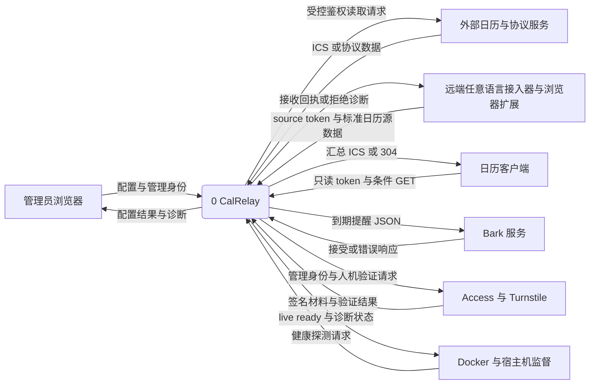
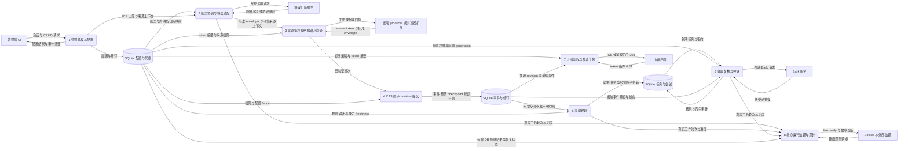
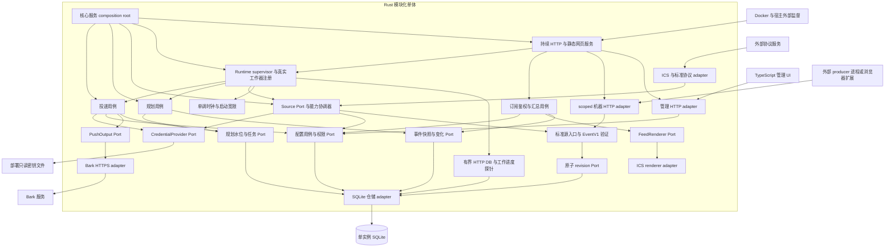
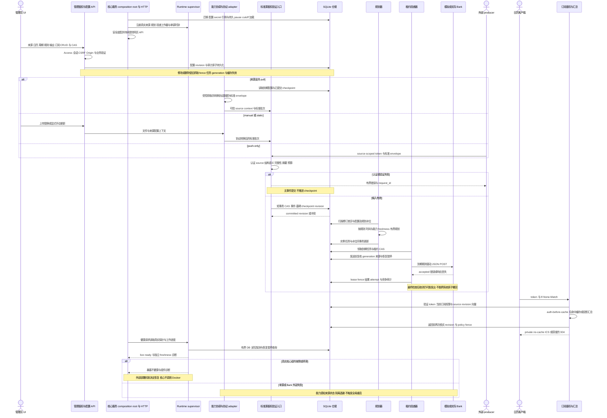

# 标准日历源与产品闭环设计

本轮设计叶子 [#72](https://github.com/freesialuo/CalRelay/issues/72)，基线 `main@5456565`（2026-10-25）。以下图是目标设计，不能据此认定实现完成。Rust 模块化单体、TypeScript 管理 UI、单实例 SQLite 与 Docker 交付保持不变；Docker 最终包含实际服务和构建前端。首版不做双向远端日历写回、跨源智能合并或任意进程内插件。

已实现基础：EventV1 领域校验/兼容性评估、SQLite 原子同步/规划水位/租约恢复、受限 ICS 与 HTTPS adapter、标准机器写入 API、ICS renderer、Bark adapter、凭据、备份恢复、管理鉴权模块。标准 binary 可启动基础 HTTP，但 `Server::initialize` 的 `admin=None`，尚未装配管理 verifier/secret provider、生产来源扫描/规划/投递循环；无实际 TS 管理闭环。模块/API/CLI 测试不等于产品验收。

未合并工作独立保留：#70 只读单源 feed 仍待 review/合并；#71 draft head `9a3cbf3` 的 CLI/监督契约已停更，其 CI/review 结果不代表 #36 完成。typed supervisor、真实 HTTP/DB probe、结束/panic/停滞检测另有云端未提交成果（父任务核实 256 Rust、17 Python 测试），本设计不修改或收录其代码/文档，真实生产工作器仍未装配。共享 runtime 注册接口由 #75 与 #36 协调冻结。

## DFD Level 0：系统上下文

矩形为外部实体，圆角节点为处理过程；边表示有内容的数据流。刷新周期是系统配置，不画成外部时钟到 store 的控制箭头。

## DFD Level 1：主要数据流

只有受控应用过程访问 SQLite；外部实体无直连 store。管理写入不等于向事件核心提交原始数据；上传 ICS 先经 adapter。图内 P3 包含认证入口及可信内部 adapter context，外部输入绝不因声称来自 adapter 而免鉴权。

失败的鉴权、越权、结构/语义校验不进入 P4，拒绝诊断不含 token 或事件正文。缓存属于 P7 的派生数据，必须在权限验证之后使用；图不为缓存增加一个外部可达真相源。

## UML 组件视图：port / adapter 与信任边界

使用 GitHub 支持的 Mermaid flowchart 表达 UML 组件依赖，标签中 Port 为应用定义接口，不宣称是现有 Rust trait 的精确名称。箭头为依赖/调用方向（不是上述 DFD 数据流）。

核心服务是持续运行的中心角色：composition root 负责安全配置、依赖装配和启动顺序，HTTP 服务持续提供网页/API，runtime supervisor 管理实际注册的来源扫描、规划和投递工作器。三者是职责分离的模块，不是将业务塞进一个巨型类，也不只是一次性调用库。domain/application 定义契约，adapters/storage 实现，server 装配。producer 无 DB、管理 API、主密钥或内部可信 context 权限；语言无关只表示协议互通。配置插件是受限 adapter 配置，远端可执行插件部署在独立进程/容器，由部署者选择隔离与资源限额，不由主服务加载任意代码。可执行下载、生命周期管理或沙箱产品化不在本轮首版承诺内。

## UML 主流程时序

拒绝响应实际返回调用方（上图 X 代表输入调用方，pull/manual 错误返回协调诊断/UI），不是向无关 producer 发消息。CAS 冲突不触发后续规划；规划与投递循环独立扫描持久状态，并非每次提交同步发送。源失败不会停止其他源。客户端 GET 决定读取时机，后台周期只负责支持 pull 的源刷新与规划；Bark 只发送到期规则，不能每周期全量盲发。

## 中心核心服务与保活边界

核心持续运行但不能承诺永不掉线。liveness 检查核心 HTTP 处理能力及实际必需工作器的进度；readiness 检查迁移、配置、安全装配、真实 DB 读写能力与必需工作器注册就绪，恢复 pause/cutoff 按安全契约反映且不得自动解除；freshness 是按来源能力的业务状态，与上述健康分离。探针使用现有 runtime 的有界操作，不再启动一套服务、任务循环或第二个 runtime，不写入敏感数据。DB 写探测仅用受控非敏感探测记录/事务且限频，具体方式由 #36/#75 冻结。

工作器报告实际工作轮次/完成与失败进度，长等待状态也有可核实生命周期；独立 ticker 不能掩盖死锁。启动宽限、超时与停滞期限使用单调时钟，业务到期时间使用 UTC Clock。HTTP/DB/必需工作器故障或停滞须暴露真实健康诊断，不能始终 200；本轮不要求核心主动自动退出或自重启，不新增恢复控制策略。已有正常关闭/实际崩溃的退出语义保留。外部源/Bark 故障隔离、退避和降级，部分接入器按能力设计间歇上线，其离线不等于核心不健康或重启理由。Docker HEALTHCHECK 只改变健康状态，普通 restart policy 主要响应进程退出；持续不健康或完全卡死时的重启控制属于系统边界外，具体部署机制/选型待 #38 确定，核心不调用 Docker API、不持有 Docker socket。健康探针无权恢复 pause 或更改 cutoff，任务与水位依然以 SQLite 为真相源。

## 标准日历源契约（目标 v1，尚待 #73 冻结）

`standard-calendar-source` 是能力与生命周期协议，`EventV1` 是它的事件正文；两者不互相替代。现有 #30 的单事件 upsert/delete 与 #29 内部批次作为已交付兼容基础，新批次端点/持久状态需 #73 明确版本迁移，本文不宣称现有 API 已支持所有 envelope。

| 部分 | 契约与拒绝行为 |
| --- | --- |
| 源配置/能力 | 稳定 source_id、adapter 类型/版本、日历 external_id 映射、enabled、配置 revision；pull/manual-static/push-only，支持 snapshot/delta/upsert/delete、条件读取、分页与显式 freshness SLA；禁止虚构能力 |
| envelope | protocol_version、batch/run id、mode、base source/config revision、checkpoint/增量基线、规范化内容摘要、完整性证明、操作列表；source 身份从 token/可信 adapter context 注入，正文不得覆盖 |
| upsert/delete | upsert 携带 EventV1，结构后再做时间/重复/归属语义验证；delete 是显式 external_uid 与预期修订，不用缺失/非法正文表示删除；跨源 UID 独立，源内日历移动保留事件身份 |
| snapshot | 分页齐全且可信才提交，缺失才可生成墓碑；无本地快照的 304 错误；空/大规模删除需阈值审核，不完整、超预算和非法任一记录整批拒绝 |
| delta | 必须匹配已提交 checkpoint/基线，缺失或过期基线要求重新 snapshot；仅显式 delete，失败不推进游标；checkpoint 与事件/修订日志同事务 |
| 幂等/摘要/CAS | key 按认证 principal/source/route 分区，规范摘要忽略无关编码差异但不能改变语义；同 key 异摘要冲突，重试可重放原回执；旧配置/源 revision CAS 拒绝迟到批次；摘要算法、规范化、TTL/容量值由 #73 冻结并契约测试 |
| token/重放 | 独立机器 token 只绑定授权来源与操作，撤销/过期即时拒绝；撤销后不因缓存幂等回执放行；过期幂等记录后的旧批次仍需基线/CAS fence，不能重放覆盖新修订；token 轮换不赋管理权限 |
| 预算/错误 | 请求/解压大小、分页/事件/时区/展开数、时间与并发均有界；鉴权拒绝、无权限、结构/语义、冲突/基线、限流与暂时故障分别有稳定错误码及 request_id，日志无正文/凭据；具体 wire 状态兼容现有 #30，不凭设计另造已实现端点 |

生命周期目标：创建为未启用配置，验证成功后显式启用；手动刷新不隐式恢复 disabled/paused；凭据失效或大规模删除审核可进入可见暂停，管理员确认后以新 config revision 恢复。删除来源采用逻辑退休并撤销 producer token/禁止新提交，原子作废未来任务和订阅权限引用，保留墓碑、accepted 去重及审计到既定保留期；关联订阅的失效不得自动扩大到其他来源。生命周期迁移/恢复与失败诊断由 #73 固定，不由 adapter 自行写库。

原始 ICS 只由协议 adapter 转换后进入标准边界，不允许 producer 将原始 ICS 伪装成 EventV1。修改 ICS 首版表示来源配置/URL/上传替换，不表示向远端日历写事件。

pull 仅在支持时使用周期与成功核验时间做 freshness；manual/static 默认无轮询陈旧限制，更新失败保留上次可信数据；push-only 只有显式承诺更新 SLA 时启用 freshness，否则按最后有效数据与独立启停策略规划。所有来源仍受 enabled、规则、取消与恢复 pause/cutoff 约束。

浏览器扩展只申请用户明确配置来源所需域权限，采集数据在扩展/远端转换为规范格式；使用扩展后台隔离的 token 存储，不放网页 localStorage、内容脚本、DOM 或 URL，后台仅向配置的精确 ingest origin 发请求。服务默认无通配 CORS；仅经审核的精确扩展 origin/HTTP 方法/headers，禁止携带管理 Cookie，浏览器 CORS 不替代 source token。撤销/轮换、权限收窄与恶意页面消息校验须负例验证；本轮不配置实际浏览器或第三方账号。

## 实施与验收映射

| 工作 | 原需求映射与先后 |
| --- | --- |
| #73 单一配置/标准源契约 owner | #35 AC1、#3 标准边界；前置 #72，冻结 OpenAPI/迁移/配置权威后供下游复用 |
| #74 能力感知同步 | #3 AC1–5；依赖 #73，复用 #25/#28/#29/#30 |
| #75 安全 bootstrap 与真实循环 | #7 运行基础、#35 可用服务；依赖 #73；为 #36 提供真实注册，复用 #4/#33/#34/#37 |
| #76 多来源汇总 | #5 AC1/2/5；依赖 #73/#32，不修改 #70 单来源实现 |
| #77 TS 管理旅程 | #35 AC1 页面操作、AC2 生成类型与诊断、AC3 类型/构建/操作/bundle 检查；依赖 #73，最终旅程还需 #74/#75/#76 |
| #78 系统验收 | #35 全部 AC、#5 输出、#7 恢复；依赖 #74/#75/#76/#77/#36；真实浏览器/HTTP/SQLite/周期与模拟 Bark |
| #36 核心监督 | 原 AC 保留；监督 state 可独立做，生产验收等 #75 真实组件，不能用 ticker 假 worker 结案 |
| #38 Docker 交付 | 原 AC 保留；Dockerfile 准备可早做，最终镜像等 #78/#36/#37/#35，包含服务与构建 TS UI |

#35 保留原整体验收与 #6 归属，#4/#15 维持关闭，不新增重复基础任务。首次 UI 全旅程、修改/删除在途失效、取消发送竞争审计、独立源失败、DST/UTC 跳变、重启恢复暂停、跨源稳定身份、external/browser producer 的鉴权/schema 负例均由上述任务保留 Given/When/Then 与实际验证证据。

新增逻辑依赖图 `72→73→{74,75,76,77}→78→38`，另有 `32→76`、`75→36→78`、`35/37→38`，人工拓扑检查无环。当前连接器不暴露原生 parent/sub-issue/dependency API，云端 gh 注入凭据认证失败，故既有原生关系未核实、新关系未创建；上述表仅为规划说明，不冒充 GitHub 原生关系，也不声称既有完整原生图已检查无环。未读取实际保护规则的能力限制同样保留，不修改权限/设置。

## 图的验证边界

使用 Mermaid 11.12.1 的实际 parser（Node.js + jsdom）验证 README 概览和本文四幅图；只使用 GitHub 原生 flowchart/sequenceDiagram 语法，不依赖插件、外部图片或初始化指令。未进行 GitHub 页面截图/浏览器布局验证，GitHub 当前渲染器版本及最终排版仍需 PR 页面复核；parser 通过不等于截图验收。
